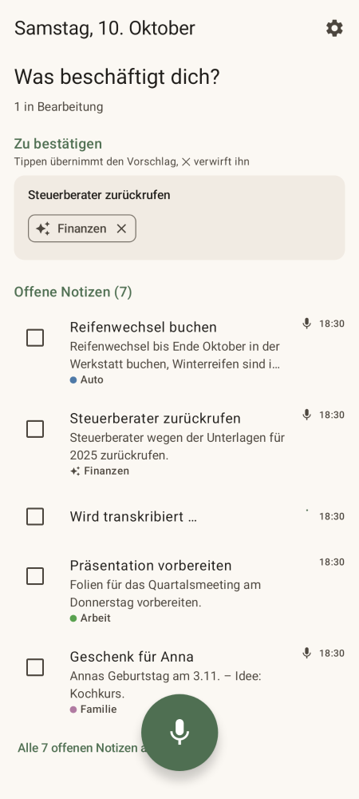
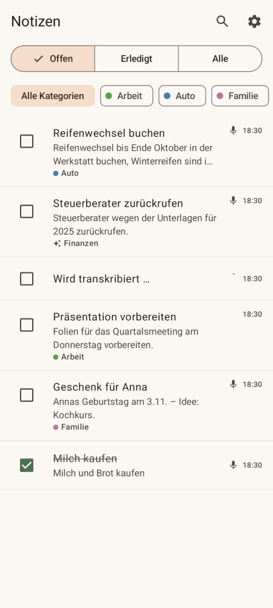
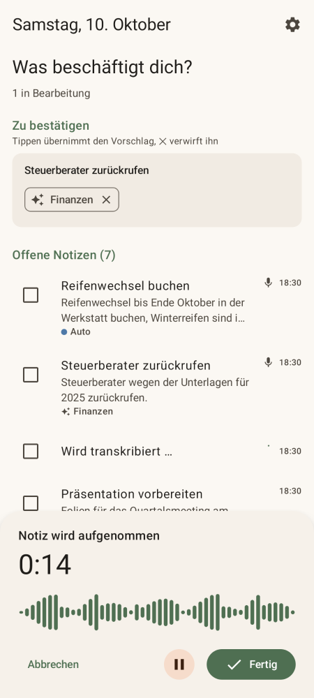
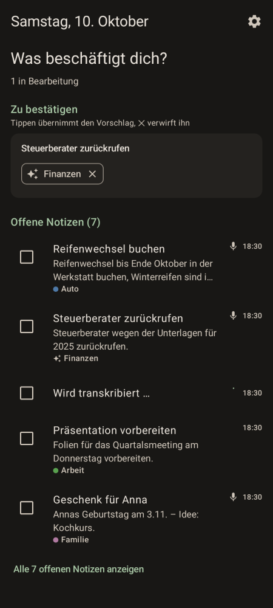

# Tagwerk

Persönliche Android-App für **diktierte Notizen** und (ab Phase 2) ein **KI-gestütztes Tagebuch** mit Achtsamkeitsfunktionen.
Das vollständige Konzept steht in [`KONZEPT.md`](KONZEPT.md).

## Stand: Phase 0 + 1 (Notizen)

- Notiz diktieren: Mikrofon **antippen** (Aufnahme läuft bis „Fertig“) oder **gedrückt halten** (Push-to-talk)
- Transkription und Einordnung über einen **OpenAI-kompatiblen Endpunkt** (eigene Base-URL + eigener API-Key)
- KI vergibt Titel und Kategorien – automatisch oder als Vorschlag (✨) zum Bestätigen
- Notizen offen/erledigt, Filter nach Status und Kategorie, Suche, Wischgesten
- Notizen auch tippen; Kategorien verwalten (umbenennen, zusammenführen, Farben)
- Offline: Aufnahmen werden gespeichert und automatisch verarbeitet, sobald Netz da ist
- Datenschutz: Datenbank (SQLCipher) und Aufnahmen sind verschlüsselt, Schlüssel im Android Keystore, kein Cloud-Backup
- Verbrauchsanzeige (Audio-Minuten, Tokens) pro Monat

<p>
  
  
  
  
</p>

## Installieren

1. Im GitHub-Repository unter **Actions → Android** den neuesten Lauf öffnen.
2. Unter *Artifacts* `tagwerk-release-…` (oder `tagwerk-debug-…`) herunterladen und entpacken.
3. Die APK auf dem Handy öffnen und die Installation aus unbekannten Quellen erlauben.
4. In der App unter **Einstellungen → KI-Verbindung** Base-URL und API-Key eintragen und „Speichern & testen“ tippen.

> **Debug- vs. Release-APK:** Die Debug-APK wird in jeder CI-Ausführung mit einem anderen Schlüssel signiert –
> ein Update erfordert dann Deinstallieren (Daten gehen verloren). Für dauerhafte Nutzung einmalig einen
> Release-Schlüssel anlegen (siehe unten); dann lassen sich neue Versionen einfach drüberinstallieren.

### Release-Schlüssel einrichten (einmalig)

```bash
keytool -genkeypair -v -keystore tagwerk-release.jks -alias tagwerk \
  -keyalg RSA -keysize 4096 -validity 36500
base64 -w0 tagwerk-release.jks > keystore.b64
```

Dann im Repository unter *Settings → Secrets and variables → Actions* anlegen:

| Secret | Inhalt |
|---|---|
| `TAGWERK_KEYSTORE_BASE64` | Inhalt von `keystore.b64` |
| `TAGWERK_KEYSTORE_PASSWORD` | Keystore-Passwort |
| `TAGWERK_KEY_ALIAS` | `tagwerk` |
| `TAGWERK_KEY_PASSWORD` | Schlüssel-Passwort |

Die `.jks`-Datei sicher aufbewahren – ohne sie lassen sich keine Updates mehr installieren.

## Entwickeln

Voraussetzungen: JDK 17+, Android SDK (Platform 35).

```bash
./gradlew testDebugUnitTest      # Unit- und Screenshot-Tests
./gradlew recordPaparazziDebug   # Screenshots neu aufnehmen (app/src/test/snapshots)
./gradlew assembleDebug          # Debug-APK
```

Lokal signierte Release-Builds: `keystore.properties` im Projektwurzelverzeichnis mit
`storeFile`, `storePassword`, `keyAlias`, `keyPassword` anlegen (wird nicht eingecheckt).

### Aufbau

```
app/src/main/java/de/bolzwerk/tagwerk/
├── AppContainer.kt        Manuelle Dependency Injection
├── core/security/         Keystore-Geheimnisse, Dateiverschlüsselung
├── data/db/               Room + SQLCipher (Notizen, Kategorien, Aufnahmen, Verbrauch)
├── data/ai/               AiProvider-Schnittstelle, OpenAI-kompatible Implementierung, Prompts
├── data/repo/             Repositories
├── data/settings/         Einstellungen (API-Key verschlüsselt)
├── domain/                Kategorie-Abgleich, KI-Pipeline (NoteProcessor)
├── audio/                 Aufnahme, Wiedergabe, verschlüsselte Ablage
├── work/                  WorkManager: Verarbeitung (wartet auf Netz), Aufräumen alter Aufnahmen
└── ui/                    Jetpack Compose (Heute, Notizen, Detail, Einstellungen, Kategorien, Aufnahme)
```
